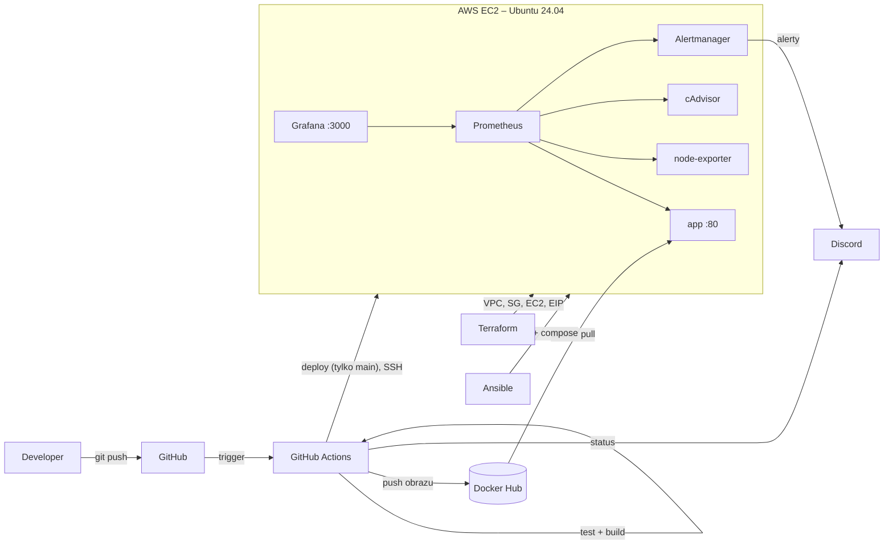

# DevOps Projekt – CI/CD, IaC i monitoring

Projekt dyplomowy: prosta aplikacja webowa w Go, automatycznie budowana, publikowana jako obraz Dockera
i wdrażana na serwer w AWS. Infrastruktura powstaje z kodu (Terraform + Ansible), a aplikację i serwer
monitoruje Prometheus z Grafaną. Wyniki pipeline'u i alerty trafiają na Discorda.

## Architektura



## Stos technologiczny

| Obszar | Narzędzie |
|---|---|
| Aplikacja | Go 1.22 (bez zewnętrznych zależności), testy jednostkowe `go test` |
| Konteneryzacja | Docker (multi-stage build, obraz distroless, użytkownik nonroot) |
| Rejestr artefaktów | Docker Hub |
| CI/CD | GitHub Actions |
| Infrastruktura | Terraform (AWS: VPC, podsieć, IGW, Security Group, EC2, Elastic IP) |
| Konfiguracja | Ansible (Docker, docker compose, monitoring) |
| Monitoring | Prometheus, node-exporter, cAdvisor, Grafana, Alertmanager |
| Powiadomienia | Discord (webhook) – pipeline i alerty |

## Struktura repozytorium

```
app/                     kod aplikacji + testy
Dockerfile               budowanie obrazu
terraform/               infrastruktura AWS
ansible/                 konfiguracja serwera, docker-compose, Prometheus, Grafana
  templates/             szablony konfiguracji (compose, prometheus, alerty, alertmanager)
  files/grafana/         gotowy dashboard
.github/workflows/       pipeline CI/CD
Makefile                 skróty: make all / make destroy
```

## Pipeline CI/CD

| Zdarzenie | Testy | Build + push na Docker Hub | Deploy na AWS | Powiadomienie |
|---|---|---|---|---|
| push do dowolnej gałęzi | ✅ | ✅ (tagi `sha-xxxxxxx`, `nazwa-gałęzi`) | – | ✅ |
| push do `main` | ✅ | ✅ (dodatkowo tag `latest`) | ✅ | ✅ |

Deploy łączy się z serwerem po SSH, ustawia nowy tag obrazu w `/opt/devops-projekt/.env`,
robi `docker compose pull && up -d app`, a potem smoke testem sprawdza, czy strona pokazuje nową wersję.
Job `notify` uruchamia się zawsze i wysyła na Discorda status każdego etapu.

## Wymagania wstępne

Lokalnie: `terraform` ≥ 1.6, `ansible` ≥ 9 (pakiet pip `ansible`), `make`, AWS CLI ze skonfigurowanymi
poświadczeniami (`aws configure`).

Konta:
1. **AWS** – użytkownik IAM z kluczem dostępowym (na potrzeby projektu wystarczą uprawnienia do EC2/VPC).
2. **Docker Hub** – utwórz repozytorium `devops-projekt` i token (Account Settings → Personal access tokens, uprawnienia Read & Write).
3. **Discord** – na swoim serwerze: Ustawienia kanału → Integracje → Webhooki → Nowy webhook → skopiuj URL.
4. **GitHub** – nowe repozytorium, do którego wypchniesz ten kod.

## Wdrożenie od zera

```bash
# 1. Klucz SSH dla serwera
ssh-keygen -t ed25519 -f ~/.ssh/devops-projekt -N ""

# 2. Zmienne
cp .env.example .env                                     # uzupełnij
cp terraform/terraform.tfvars.example terraform/terraform.tfvars   # wpisz swój IP

# 3. Infrastruktura + konfiguracja serwera (dwie komendy w jednej)
make all

# 4. Adresy
make output
```

Uwaga: przed pierwszym `make all` obraz musi już istnieć na Docker Hubie – zrób najpierw jeden push
do GitHuba (krok niżej) albo wypchnij obraz ręcznie: `docker build -t LOGIN/devops-projekt:latest . && docker push LOGIN/devops-projekt:latest`.

Oba narzędzia są idempotentne: ponowne `make all` niczego nie zmienia, jeśli stan jest zgodny z kodem.

## Konfiguracja GitHub Actions

W repozytorium: **Settings → Secrets and variables → Actions**.

Secrets:

| Nazwa | Wartość |
|---|---|
| `DOCKERHUB_USERNAME` | login Docker Hub |
| `DOCKERHUB_TOKEN` | token Docker Hub |
| `SSH_PRIVATE_KEY` | zawartość `~/.ssh/devops-projekt` (klucz prywatny) |
| `SERVER_IP` | wynik `terraform output server_ip` |
| `DISCORD_WEBHOOK_URL` | URL webhooka |

Variables:

| Nazwa | Wartość |
|---|---|
| `DOCKERHUB_IMAGE` | `LOGIN/devops-projekt` |

## Monitoring

- Grafana: `http://IP:3000` (login `admin`, hasło z `GRAFANA_ADMIN_PASSWORD`) → folder *DevOps Projekt* → dashboard
  z dostępnością i wersją aplikacji, ruchem HTTP, CPU/RAM/dyskiem serwera i CPU kontenerów.
- Prometheus: `http://IP:9090` (Status → Targets pokazuje, czy wszystko jest scrapowane).
- Alerty (Alertmanager → Discord): aplikacja niedostępna > 1 min, CPU > 85% przez 5 min, dysk < 15% wolnego.

Grafana i Prometheus są dostępne tylko z adresu IP podanego w `admin_cidr`.

## Scenariusz demonstracji (10–12 min)

1. Pokaż stronę aplikacji z aktualną wersją i dashboard w Grafanie.
2. `git checkout -b feature/demo`, zmień tekst w `app/main.go` **i w `app/main_test.go`**, push →
   w Actions widać testy + build + push, bez deployu; na Discordzie powiadomienie z „Deploy: skipped”.
3. Merge do `main` (PR albo `git merge`) → pełny pipeline z deployem, po ~2–3 min strona pokazuje nowy tag `sha-…`.
4. Pokaż nowe tagi na Docker Hubie.
5. Opcjonalnie: `ssh ubuntu@IP 'cd /opt/devops-projekt && docker compose stop app'` → po ~1 min alert na Discordzie,
   panel „Status aplikacji” w Grafanie zmienia się na DOWN; `docker compose start app` → alert „resolved”.
6. Opcjonalnie: commit z błędem w teście → czerwony pipeline i powiadomienie o porażce.

## Koszty i sprzątanie

t3.small w eu-central-1 to około 0,02–0,03 USD/h (plus Elastic IP), czyli kilkanaście dolarów miesięcznie
przy pracy ciągłej. Po obronie:

```bash
make destroy
```

## Uruchomienie lokalne

```bash
make test     # testy jednostkowe
make local    # aplikacja na http://localhost:8080
```
