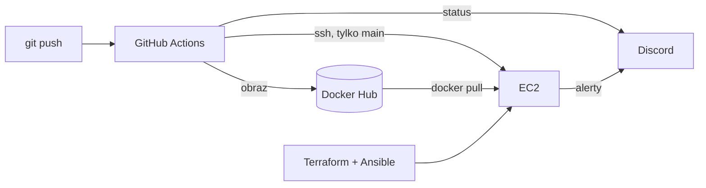

# devops-project

Projekt dyplomowy z kursu DevOps. Mała aplikacja w Go, którą GitHub Actions testuje, pakuje w obraz
Dockera i wrzuca na Docker Hub, a z gałęzi `main` dodatkowo wdraża na serwer w AWS. Serwer stawia
Terraform, konfiguruje Ansible. Na serwerze chodzi też Prometheus z Grafaną, a alerty i wyniki
pipeline'u lecą na Discorda.

Sama aplikacja jest celowo prosta (strona z wersją, `/health` i `/metrics`), bo w projekcie chodziło
o proces wokół niej, a nie o kod.



## Co jest w repo

- `app/` – aplikacja i testy (`go test`)
- `Dockerfile` – build dwuetapowy, w wyniku obraz distroless ma kilka MB
- `terraform/` – VPC, podsieć, security group, EC2 (Ubuntu 24.04, t3.small), Elastic IP
- `ansible/` – instalacja Dockera i uruchomienie wszystkiego przez docker compose; w `templates/`
  konfiguracja Prometheusa, Alertmanagera i Grafany, w `files/` dashboard
- `.github/workflows/ci-cd.yml` – pipeline
- `Makefile` – skróty do komend poniżej

## Pipeline

Każdy push, na dowolną gałąź:

1. `go vet` i testy
2. build obrazu i push na Docker Hub z tagiem `sha-<commit>` i nazwą gałęzi (na `main` dodatkowo `latest`)
3. powiadomienie na Discordzie ze statusem każdego kroku

Na `main` między 2 a 3 dochodzi deploy: Actions łączy się po SSH z serwerem, wpisuje nowy tag do
`/opt/devops-projekt/.env` i robi `docker compose up -d app`. Na koniec smoke test sprawdza, czy
strona zwraca już nową wersję. Jeśli nie, job jest czerwony.

Deploy jest pomijany, dopóki w repo nie ma zmiennej `SERVER_IP`, żeby dało się zbudować pierwszy obraz,
zanim powstanie serwer.

## Uruchomienie od zera

Potrzebne: konto AWS z użytkownikiem IAM (`AmazonEC2FullAccess`), skonfigurowane `aws configure`,
lokalnie `terraform`, `ansible` i `make`.

```bash
ssh-keygen -t ed25519 -f ~/.ssh/devops-projekt -N ""

cp .env.example .env                                  # obraz z Docker Huba, webhook, hasło do Grafany
cp terraform/terraform.tfvars.example terraform/terraform.tfvars   # admin_cidr = swoje IP/32

make all       # terraform apply + ansible-playbook
make output    # adresy
```

Obraz `latest` musi już być na Docker Hubie, więc najpierw trzeba raz wypchnąć kod na `main`.

`make all` można puszczać wielokrotnie – Terraform i Ansible nic nie zmieniają, jeśli stan się zgadza.
Terraform sam generuje `ansible/inventory.ini` z adresem nowej maszyny.

`make destroy` usuwa wszystko z AWS. Po ponownym `make all` serwer ma nowe IP, więc trzeba
zaktualizować `SERVER_IP` w GitHubie.

### Sekrety w GitHub Actions

Secrets: `DOCKERHUB_USERNAME`, `DOCKERHUB_TOKEN` (token z uprawnieniem Read & Write),
`DISCORD_WEBHOOK_URL`, `SSH_PRIVATE_KEY` (prywatny klucz z `~/.ssh/devops-projekt`).

Variables: `DOCKERHUB_IMAGE` (np. `login/devops-projekt`), `SERVER_IP`.

## Monitoring

Prometheus zbiera metryki co 15 s z:

- aplikacji (`/metrics` – liczba zapytań, uptime, wersja),
- node-exportera (CPU, RAM, dysk serwera),
- cAdvisora (zużycie przez poszczególne kontenery).

Grafana jest na porcie 3000 (login `admin`), dashboard „DevOps Projekt – przegląd” wgrywa się sam.
Grafana i Prometheus są dostępne tylko z adresu z `admin_cidr`.

Reguły alertów są w `ansible/templates/alert-rules.yml.j2`: aplikacja nie odpowiada przez minutę,
CPU powyżej 85% przez 5 minut, mniej niż 15% wolnego dysku. Alertmanager wysyła je na ten sam kanał
na Discordzie co pipeline.

## Dlaczego tak, a nie inaczej

- **GitHub Actions zamiast Jenkinsa** – nie trzeba stawiać i utrzymywać osobnego serwera CI.
- **Jedna EC2 z docker compose zamiast EKS** – EKS kosztuje sam w sobie, a przy jednej aplikacji
  Kubernetes nic by nie wniósł. Całość mieści się w darmowych kredytach AWS.
- **Deploy przez SSH** – najprostsza rzecz, która działa. Wadą jest otwarty port 22 (runnery GitHuba nie
  mają stałych IP); logowanie jest tylko kluczem.
- **Tag `sha-<commit>` zamiast samego `latest`** – zawsze wiadomo, która wersja chodzi na serwerze,
  i da się wrócić do poprzedniej.

## Czego brakuje

- HTTPS – wymagałby domeny; najprościej byłoby dodać Caddy przed aplikacją.
- Stan Terraforma trzymany lokalnie. W `versions.tf` jest zakomentowany backend S3.
- Logi tylko przez `docker compose logs`, bez centralnego zbierania (Loki byłby następnym krokiem).
- Brak automatycznego rollbacku – po nieudanym smoke teście trzeba ręcznie ustawić poprzedni tag w `.env`.

## Lokalnie

```bash
make test
make local     # http://localhost:8080
```
